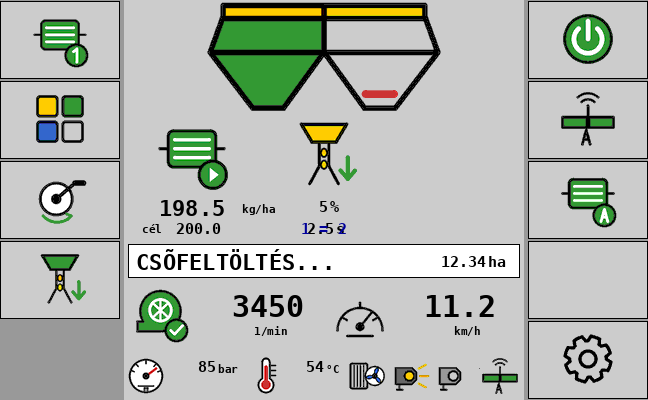
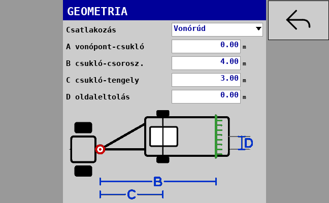

# Vetőgép ISOBUS vezérlő – ESP32-S3 (v2)

Saját ISOBUS munkagép-vezérlő (ECU) **Accord-típusú, térfogatos (változó volumenű) adagolós**
vetőgéphez. A Müller (és más ISO 11783 VT3+) terminálon saját kezelőfelülettel jelenik meg,
Task Controllerrel együttműködik (TC-BAS / TC-SEC / TC-GEO), és Wi-Fi-n webes felülete is van.
Az alapokat a permetező-vezérlő adja (paraméterrendszer, web, OTA, tesztek), a VT stílusa és az
ikonok az ESC vetőgép-monitorból jönnek.

## Mit tud

| Terület | Funkció |
|---|---|
| Gép | munkaszélesség (alap 6 m), 1–2 adagoló, 1–2 tartály(rekesz), 1–2 szakasz; két adagolónál bal/jobb félszélesség vagy első/hátsó sor (mindkettő a teljes szélességet veti) |
| Hajtás | **talajhajtás + elektromágneses kuplung** adagolónként (áram alatt hajt / old), vagy **elektromos motor** adagolónként enkóderrel (alap 50 imp/ford), PWM min/max, rámpák, PI + előrecsatolás |
| Adagolás | előírt mennyiség adagolónként (kg/ha), ±% léptetés; elektromos hajtásnál a kg/ha a leforgatásból kapott kg/fordulattal motorfordulatra számolva; **„2. = 1. adagoló”** összekapcsolás (azonos vetőmagnál az előírt érték és a kg/fordulat egyforma, főképernyőn „1 = 2”) és egyszeri 1. → 2. másolás |
| Kézi adagolás | elektromos hajtásnál AUTOMATA ↔ KÉZI: kézi módban a +/− a motorfordulatot lépteti, a sebességtől függetlenül (a vetés feltételei továbbra is kellenek) |
| Csőfeltöltés | elektromos hajtásnál induláskor (gép leengedése / vetés BE álló gépnél) a motor a beállított „feltöltési sebességgel” előre adagol, majd „START – indulhatsz” várakozás – sarkoknál nem marad ki a vetés |
| Szakaszvezérlés | a kezelő 2 független adagoló gombja + TC-SEC. 1 szakasznál (pl. 6 m, 2 adagoló) a TC mindkét adagolót együtt kapcsolja, a kezelő gombjai továbbra is külön működnek |
| Sebesség | kerékjeladó (imp/100 m, **100 m-es kalibrálás** vagy kézi megadás), ISOBUS (föld/radar/GPS, traktor kerék, gép által választott, NMEA), ISOBUS + kerék tartalék, szimulált sebesség |
| Munkakapcsoló | nincs / NO / NC érintkező; ha van, a „lent” a vetés feltétele; opció: a TC automatikus szakaszvezérlésnél is számítson-e |
| Turbina | imp/fordulat, min. és max. fordulat riasztás késleltetéssel; csak munka közben riaszt (munkakapcsolóval: lent + halad; nélküle: halad + vetés BE) |
| Adagolófigyelés | talajhajtásnál: ha a hajtott adagolóról a beállított időn belül nem jön impulzus → riasztás; motornál: enkóder hiány és „mennyiség nem tartható” riasztás |
| Tartályok | 2 normál kapcsoló, NO/NC menüből vagy webről, szűrési idővel |
| Leforgatás | Accord beállítási táblázat (14 növény, normál és aprómag N/M hajtás), 85 / 42,5 / 17 fordulat, várható tömeg, mért tömegből új skála és kg/fordulat mentése; motoros hajtásnál pontosan N fordulatot tesz meg a motor |
| Mérleg | HX711 + 50 kg-os cella („vödör”): méréshatár, tárázás, kalibrálás ismert súllyal; a leforgatásnál a tömeg egy gombbal átvehető (alapból kikapcsolva) |
| Nyomás | ADS1115 + lenyomatási nyomásszenzor: méréshatár (pl. 250 bar), jel 0–5 / 0,5–4,5 / 0,5–5 / 0–4,5 V, **egypontos kalibrálás** ismert nyomáson; bekapcsolva piktogram + bar a főképernyőn (alapból ki) |
| Lámpák | 2 munkalámpa külön kapcsolva (alapból ki) |
| Funkcióváltó | hidraulika terelőszelep: szétnyitás ↔ nyomjelző (alapból ki) |
| Olajhűtés | 2 db DS18B20 (olajtartály, hűtő kimenet), ventilátor BE a felső, KI az alsó hőfoknál; automata és kézi mód, túlmelegedés riasztás |
| Task Controller | DDOP a beállításokból: csatlakozó (függesztett, kormányzott vonórúd csuklóponttal, vonórúd, horog, gömbfej), A/B/C/D geometria, szakaszok, adagolónként termék (bin) kg/ha előírttal; változáskor automatikus újratöltés |
| Kezelés | VT (softkey + gombos menü + beviteli mezők, ESC stílusú ikonok, szürke háttér) és Wi-Fi web (telefon / tablet), OTA frissítés |

## A terminál képernyői

A képek a generált object poolból készülnek (`docs/vt_preview/`), a Müller BASIC elrendezésében
(400×400 maszk, 120×80 softkey: az első 5 gomb a jobb oszlop, a többi a bal).

| Főképernyő | Funkciók | Csőfeltöltés (1 adagoló) |
|---|---|---|
|  |  |  |

| Beállítás menü | Leforgatás | Geometria |
|---|---|---|
|  |  |  |

**Főképernyő softkey-ek** – jobb oszlop: Vetés BE/KI · 2. adagoló · TC szakaszvezérlés ·
AUTOMATA/KÉZI (motoros hajtás; talajhajtásnál itt a Funkciók) · Beállítások; bal oszlop: 1. adagoló ·
Funkciók · Leforgatás · Csőfeltöltés (csak motoros hajtásnál). A Számlálók a Beállítások menüben vannak.
Az automata szakaszvezérlést a Task Controller (navigáció) kapcsolja: a gép kezelői gomb nélkül átveszi
és kijelzi; a saját gombbal a kezelő kézire válthat, ezt a TC is megkapja.
**Funkciók:** vissza · előírt +/−/100% · nyugtázás · lámpa 1/2 · szétnyitás/nyomjelző · hűtő
(automata → kézi BE → kézi KI). A gombok csak a bekapcsolt kiegészítőknél jelennek meg.

**Adagoló ikon:** kész · hajt · lekapcsolva (szakasz/gomb) · hiba · áll. Az állapotsor: VETÉS KI /
GÉP KIEMELVE / ÁLL / VETÉS / CSŐFELTÖLTÉS / START, figyelmeztetésnél a hiba szövege; a parancsok
visszajelzése (pl. „Leforgatás csak álló gépnél”) 4 másodpercig látszik.

A képek pontos pixelméretű 8 bites képek a szürke háttérre simítva, így a BASIC terminálon
nincs VT-oldali méretezés. Más felbontásnál az AgIsoStack++ feltöltés előtt átméretezi a poolt
(PC-s szimulációval 400 és 480 px-re ellenőrizve). A pool verziócímkéje a tartalomból képződik.

## Panelek és bekötés

Két firmware készül, ugyanabból a kódból:

### AgIsoAuxInputs ESP32-S3R8N8 (8 MB) – amin az ESC monitor fut

| Jel | Láb | Megjegyzés |
|---|---|---|
| CAN | GPIO10 / GPIO11 | beépített transceiver |
| Kerékjeladó | GPIO9 (H7) | |
| Turbina | GPIO8 (H7) | |
| Bal (1.) tartály | GPIO7 (H7) | a sérült BTN0 helyett |
| Jobb (2.) tartály | BTN5 | |
| 1. / 2. adagoló reed | BTN2 / BTN3 | 5 ms mintavétel, 15 ms pergésszűrés |
| Munkahelyzet | BTN4 | |
| 1. / 2. kuplung | BTN6 / BTN1 (kimenet) | PCA9555 |
| Terelőszelep | BTN7 (kimenet) | |
| Lámpa 1 / 2 | GPIO48 / GPIO47 (H5/H6 „LED”) | relémodulra |
| Hűtőventilátor | GPIO18 (optós kapcsolókimenet) | relére |
| Nyomásszenzor | panelen lévő ADS1115 A0 (I2C 0x48) | 3,3 V-os bemenet: 5 V-os szenzorhoz osztó kell (Beállítások → Nyomás → osztó) |

**Nincs szabad láb:** elektromos adagolómotor, HX711 mérleg, DS18B20 hőmérők – ezek ezen a
panelen nem működnek (a webes Rendszer oldal „nincs a panelen”-t mutat). A szimulációval mindegyik
kipróbálható.

### Waveshare ESP32-S3-ETH-8DI-8RO-C (16 MB) – minden funkcióval

| Jel | Láb |
|---|---|
| CAN | GPIO17 / GPIO18 |
| IN1 kerék · IN2 turbina · IN3/IN4 adagoló jeladó vagy enkóder · IN5 munkahelyzet · IN6/IN7 tartályok | GPIO4–10 (IN8 = GPIO11 tartalék) |
| Relé 1/2 kuplungok · 3 terelőszelep · 4/5 lámpák · 6 hűtőventilátor (7–8 tartalék) | TCA9554 (I2C 0x20, SDA 42 / SCL 41) |
| Motor PWM 1 / 2 | GPIO47 / GPIO48 (Cytron MD13S / IBT-2, egy irány) |
| HX711 | GPIO1 adat / GPIO2 órajel |
| DS18B20 × 2 | GPIO3 (1-Wire, 4,7 kΩ felhúzó 3,3 V-ra) |
| ADS1115 (külső, 5 V, I2C szintillesztővel) | A0 nyomás, A1–A2 motoráram (ACS712), A3 tartalék |

A két DS18B20 sorrendje a ROM-azonosítójuk szerint alakul; ha fordítva látszik, Beállítások →
Olajhőmérséklet → „hőmérők felcserélése”.

**A kimenetek** csak az első vezérlési ciklus után kapnak meghajtást, induláskor a vetés KI
(kuplungok a beállított típus szerint „old”, motor 0 %).

## Telepítés

A GitHub Actions minden `main` ágra küldött változásnál lefordítja a firmware-t és a
**„legujabb”** kiadásba teszi:

* `VETOGEP_AGISOAUX_8MB_vXXX_FULL_0x0.bin` / `…_OTA.bin`
* `VETOGEP_WAVESHARE_16MB_vXXX_FULL_0x0.bin` / `…_OTA.bin`

**Első telepítés USB-n:** https://espressif.github.io/esptool-js/ → Connect → a `FULL_0x0.bin`
fájl **0x0** címre → Program.

**Frissítés Wi-Fi-n:** csatlakozz a `VETOGEP-xxxx` hálózathoz (jelszó alapból `12345678`),
nyisd meg a http://192.168.4.1 címet → Rendszer → Firmware frissítés → `…_OTA.bin`. A FULL fájlt
az OTA oldal elutasítja. Hibás új firmware esetén a bootloader visszaáll az előzőre.

## Webes felület

Szürke téma, öt fül: **Munka** (vetés, adagolók, sebesség, turbina, kiegészítők) ·
**Beállítások** (a paraméterek csoportokban, a kikapcsolt kiegészítők és a nem releváns mezők
rejtve) · **Kalibrálás** (leforgatás, beállítási táblázat, mérleg, kerékjeladó, nyomás) ·
**Számlálók** · **Rendszer** (ISOBUS, I/O és hardver diagnosztika, export/import, OTA, napló).

## Fejlesztés

```
python tools/gen_params.py                 # paramétertábla → include/seeder/params_gen.hpp + docs/PARAMETEREK_HU.md
python tools/pool/generate_pool.py --preview   # VT object pool + vt_ids.hpp + előnézetek
python -m unittest discover -s tests/python    # pool és kiadás tesztek
cmake -S host -B build-host && cmake --build build-host -j && ctest --test-dir build-host --output-on-failure
```

* `tools/params_def.py` – minden paraméter egy helyen (VT, web, NVS, dokumentáció ebből készül)
* `src/core` – hordozható vezérlőmag (sebesség, adagolás, motorszabályzás, feltöltés, figyelés,
  leforgatás, mérleg, nyomás, hűtés) – PC-n unit tesztelve (`tests/host/test_core.cpp`)
* `src/app` – ISOBUS réteg: VT kezelőfelület, TC kliens (DDOP), web API
* `src/esp` – panelprofilok, I/O, Wi-Fi, OTA, NVS
* `tests/host/isobus_sim.cpp` – teljes ISOBUS szimuláció virtuális CAN-en (VT + TC szerver)
* `tests/host/web_demo.cpp` – a webes felület PC-n (`-DSEEDER_WEB_DEMO=ON`, majd `web_demo 8080`)

A paraméterek leírása: [docs/PARAMETEREK_HU.md](docs/PARAMETEREK_HU.md).
