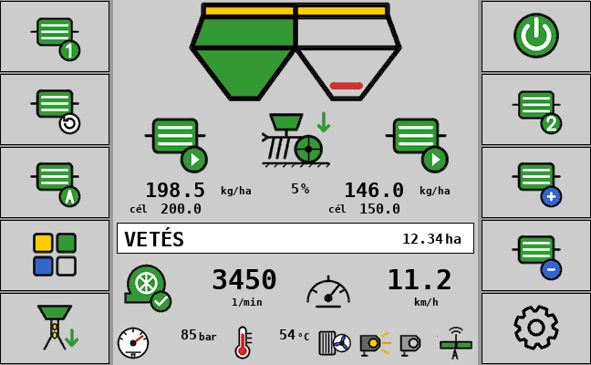
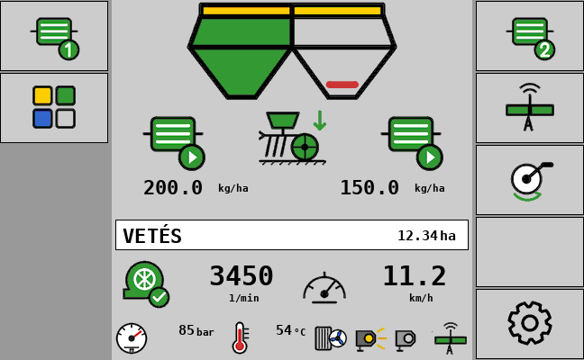
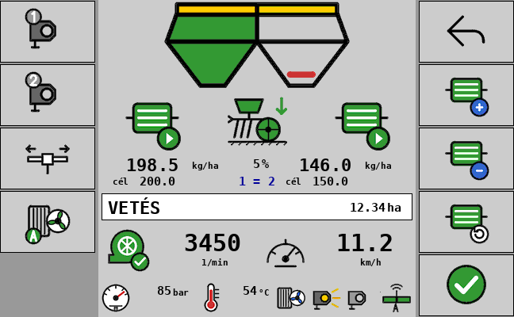
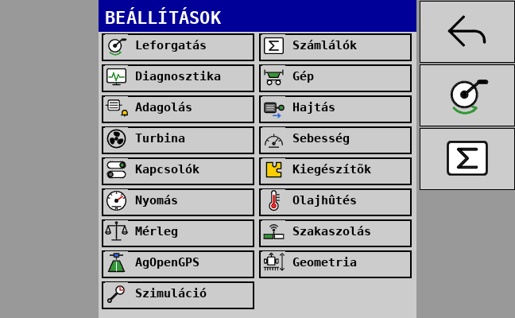
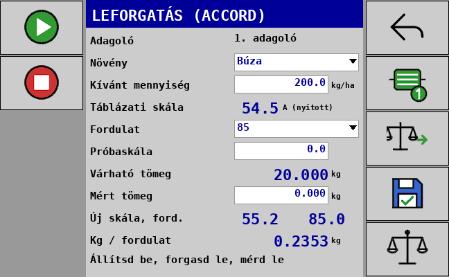
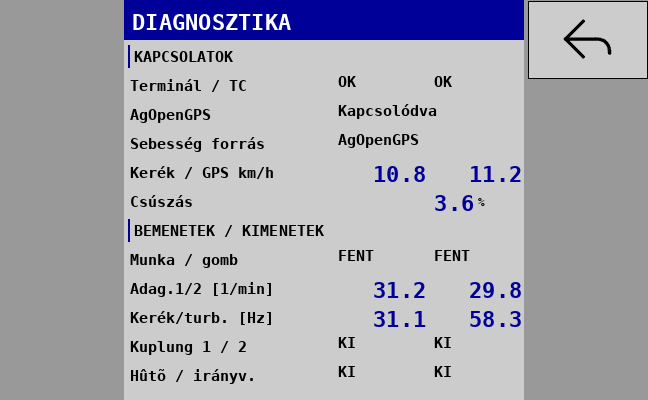

# Vetőgép ISOBUS vezérlő – ESP32-S3 (v2)

Saját ISOBUS munkagép-vezérlő (ECU) **Accord-típusú, térfogatos (változó volumenű) adagolós**
vetőgéphez. A Müller (és más ISO 11783 VT3+) terminálon saját kezelőfelülettel jelenik meg,
Task Controllerrel együttműködik (TC-BAS / TC-SEC / TC-GEO), és Wi-Fi-n webes felülete is van.
Az alapokat a permetező-vezérlő adja (paraméterrendszer, web, OTA, tesztek), a VT stílusa és az
ikonok az ESC vetőgép-monitorból jönnek.

## Mit tud

| Terület | Funkció |
|---|---|
| Gép | munkaszélesség (alap 6 m), 1–2 adagoló, 1–2 tartály(rekesz), 1–2 szakasz; két adagolónál bal/jobb félszélesség vagy első/hátsó sor (mindkettő a teljes szélességet veti) |
| Hajtás | **talajhajtás + elektromágneses kuplung** adagolónként (áram alatt hajt / old), vagy **elektromos motor** adagolónként enkóderrel (alap 50 imp/ford), PWM min/max, rámpák, PI + előrecsatolás |
| Adagolás | előírt mennyiség adagolónként (kg/ha), ±% léptetés; elektromos hajtásnál a kg/ha a leforgatásból kapott kg/fordulattal motorfordulatra számolva; a leforgatott adagoló adatai (kg/fordulat + előírt érték) **egy gombbal átmásolhatók a másik adagolóra** (bármelyik irányban) |
| Kézi adagolás | elektromos hajtásnál AUTOMATA ↔ KÉZI: kézi módban a +/− a motorfordulatot lépteti, a sebességtől függetlenül (a vetés feltételei továbbra is kellenek) |
| Csőfeltöltés | elektromos hajtásnál induláskor (gép leengedése / vetés BE álló gépnél) a motor a beállított „feltöltési sebességgel” előre adagol, majd „START – indulhatsz” várakozás – sarkoknál nem marad ki a vetés |
| Szakaszvezérlés | a kezelő 2 független adagoló gombja + automata szakaszolás. **Forrás választható: Nincs / ISOBUS Task Controller (TC-SEC) / AgOpenGPS.** 1 szakasznál (pl. 6 m, 2 adagoló) az automata mindkét adagolót együtt kapcsolja, a kezelő gombjai továbbra is külön működnek. A tehetetlenség BE/KI csak az ISOBUS TC-nek szól (AgOpenGPS-nél az előretekintést ott kell beállítani) |
| AgOpenGPS | Ethernetes panelen (Waveshare) gépmodulként jelenik meg az AgIO-ban (5.7.2, 6.3.3, 6.7): **sebesség** (PGN 254), **szakaszok** (PGN 239), **festés / munkakapcsoló** (PGN 234: gép lent = főkapcsoló BE; zöld = automata, sárga = kézi). Leengedéskor 3 BE csomag, utána csend (az AgOpenGPS-ben kézzel leállítható), kiemelve KI 500 ms-onként. Fix IP (alap 192.168.5.130, az AgIO alhálózat-állítása átírja) vagy DHCP. Az autokormány-modulhoz (PGN 253) nem nyúl |
| Sebesség | kerékjeladó (imp/100 m, **100 m-es kalibrálás** vagy kézi megadás), ISOBUS (föld/radar/GPS, traktor kerék, gép által választott, NMEA), ISOBUS + kerék tartalék, **AgOpenGPS, AgOpenGPS + kerék tartalék**, szimulált sebesség; **kerék – GPS eltérés (csúszás)** kijelzés és riasztás késleltetéssel, hiszterézissel |
| Munkakapcsoló | nincs / NO / NC érintkező; ha van, a „lent” a vetés feltétele; opció: a TC automatikus szakaszvezérlésnél is számítson-e. **Talajhajtásnál nincs vetés BE/KI gomb: a munkakapcsoló és a haladás indítja a vetést** |
| Kuplung | talajhajtásnál alapból **nem old kiemeléskor / megálláskor** (kiemelt gépnél úgysem forog), csak a szakaszolás és az adagológombok kapcsolják; a régi működés („old”) beállítható |
| Turbina | imp/fordulat, min. és max. fordulat riasztás késleltetéssel; csak munka közben riaszt (munkakapcsolóval: lent + halad; nélküle: halad + vetés BE) |
| Adagolófigyelés | talajhajtásnál: ha a hajtott adagolóról a beállított időn belül nem jön impulzus → riasztás; motornál: enkóder hiány és „mennyiség nem tartható” riasztás |
| Tartályok | 2 normál kapcsoló, NO/NC menüből vagy webről, szűrési idővel |
| Leforgatás | Accord beállítási táblázat (14 növény, normál és aprómag N/M hajtás), 85 / 42,5 / 17 fordulat, várható tömeg, új skála és kg/fordulat mentése. **Motoros hajtásnál nyomva tartásos** (VT gomb, telefon, gépre szerelt gomb az IN8-on): amíg nyomod, forog; elengedve megáll, a számláló megmarad – **megszakítható, folytatható**; a célfordulatnál magától megáll (kikapcsolható). **Részmérések** (vödrönként, max. 10, törölhetők) összeadódnak, a kg/fordulat a **ténylegesen megszámolt fordulatból** számolódik. 1 imp/ford jeladónál az első jel a nullpont, 42,5-nél a fél fordulatot a kezelő teszi rá. Visszajelzés: munkalámpa röviden villan fordulatonként, célnál gyorsan villog, majd folyamatosan világít; a panel hangjelzője; a telefonon nagy számláló, célnál piros + hang |
| Mérleg | HX711 + 50 kg-os cella („vödör”): méréshatár, tárázás, kalibrálás ismert súllyal; a leforgatásnál a tömeg egy gombbal átvehető (alapból kikapcsolva) |
| Nyomás | ADS1115 + lenyomatási nyomásszenzor: méréshatár (pl. 250 bar), jel 0–5 / 0,5–4,5 / 0,5–5 / 0–4,5 V, **egypontos kalibrálás** ismert nyomáson; bekapcsolva piktogram + bar a főképernyőn (alapból ki) |
| Lámpák | 2 munkalámpa külön kapcsolva (alapból ki) |
| Funkcióváltó | hidraulika terelőszelep: szétnyitás ↔ nyomjelző (alapból ki) |
| Olajhűtés | 2 db DS18B20 (olajtartály, hűtő kimenet), ventilátor BE a felső, KI az alsó hőfoknál; automata és kézi mód, túlmelegedés riasztás; **visszafúvás** (relé 7: motor polaritásváltó vagy hidraulika irányváltó): kézi gomb vagy időzített (perc), biztonságos sorrend: leállás → irányváltás → visszafúj → leállás → vissza |
| ISOBUS indulás | késleltetett bejelentkezés (lassabban induló terminál, pl. Müller), automatikus ismételt bejelentkezés, ha nincs terminál, VT kapcsolat újrakezdése; webes **„ISOBUS újracsatlakozás”** gomb |
| Diagnosztika | VT-n és weben: kapcsolatok (VT, TC, AgOpenGPS, Ethernet), sebességforrás, kerék / GPS, csúszás, bemenetek, kimenetek, csomagszámlálók |
| Task Controller | DDOP a beállításokból: csatlakozó (függesztett, kormányzott vonórúd csuklóponttal, vonórúd, horog, gömbfej), A/B/C/D geometria, szakaszok, adagolónként termék (bin) kg/ha előírttal; változáskor automatikus újratöltés |
| Kezelés | VT (softkey + gombos menü + beviteli mezők, ESC stílusú ikonok, szürke háttér) és Wi-Fi web (telefon / tablet), OTA frissítés |

## A terminál képernyői

A képek a generált object poolból készülnek (`docs/vt_preview/`), a Müller BASIC elrendezésében
(400×400 maszk, 120×80 softkey: az első 5 gomb a jobb oszlop, a többi a bal).

| Főképernyő (motoros hajtás) | Főképernyő (talajhajtás) | Funkciók |
|---|---|---|
|  |  |  |

| Beállítás menü | Leforgatás | Diagnosztika |
|---|---|---|
|  |  |  |

**Főképernyő softkey-ek, motoros hajtás** – jobb oszlop: Vetés BE/KI · 2. adagoló · + · − · Beállítások;
bal oszlop: 1. adagoló · 100% · AUTOMATA/KÉZI · Funkciók · Csőfeltöltés.
**Talajhajtás** – nincs vetés gomb (a munkakapcsoló indít), nincs +/− és 100% (a dózist a váltó adja):
jobb oszlop: 2. adagoló (kuplung) · automata szakaszolás · leforgatás · Beállítások; bal: 1. adagoló · Funkciók.
A főlapon talajhajtásnál a **beállított kg/ha** látszik, „cél” sor nélkül.
Az automata szakaszolást a navigáció (TC vagy AgOpenGPS) kapcsolja: a gép kezelői gomb nélkül átveszi
és kijelzi; a saját gombbal a kezelő kézire válthat.
**Funkciók:** vissza · automata szakaszolás · leforgatás · nyugtázás · visszafúvás · lámpa 1/2 ·
szétnyitás/nyomjelző · hűtő (automata → kézi BE → kézi KI). A gombok csak a bekapcsolt kiegészítőknél
jelennek meg. **Menü:** Leforgatás · Számlálók · Diagnosztika elöl, utána a beállítóoldalak.

**Adagoló ikon:** kész · hajt · lekapcsolva (szakasz/gomb) · hiba · áll. Az állapotsor: VETÉS KI /
GÉP KIEMELVE / ÁLL / VETÉS / CSŐFELTÖLTÉS / START, figyelmeztetésnél a hiba szövege; a parancsok
visszajelzése (pl. „Leforgatás csak álló gépnél”) 4 másodpercig látszik.

A képek pontos pixelméretű 8 bites képek a szürke háttérre simítva, így a BASIC terminálon
nincs VT-oldali méretezés. Más méretű terminálon (pl. Müller / Dammann **HD12, Touch1200**) a firmware
feltöltéskor maga méretezi át a poolt: a maszk tartalma a maszk szélességével arányos, a fontok a
legközelebbi támogatott méretre állnak, a softkey-ikonok pedig a gomb kisebbik oldalához igazodnak,
középre zárva – így négyzetes vagy más arányú gombon sem lógnak ki. PC-s szimulációval 400 (120×80),
480 (80×80) és 600 px (100×64) terminálra ellenőrizve. A pool verziócímkéje a tartalomból képződik.

## Panelek és bekötés

A firmware a **Waveshare ESP32-S3-ETH-8DI-8RO-C** panelre készül (a korábbi AgIsoAuxInputs változatot már nem fejlesztjük).

### Waveshare ESP32-S3-ETH-8DI-8RO-C (16 MB) – minden funkcióval

| Láb / csatlakozó | Funkció | Megjegyzés |
|---|---|---|
| CAN TX / RX – GPIO17 / GPIO18 | ISOBUS 250 kbit/s | -C változat beépített adó-vevője |
| IN1 – GPIO4 | Kerékjeladó | optós bemenet |
| IN2 – GPIO5 | Turbina fordulat | |
| IN3 – GPIO6 | 1. adagoló: tengelyjeladó vagy motorenkóder | |
| IN4 – GPIO7 | 2. adagoló: tengelyjeladó vagy motorenkóder | |
| IN5 – GPIO8 | Munkakapcsoló (gép lent) | NO / NC beállítás |
| IN6 – GPIO9 | 1. tartály leürülésgátló | NO / NC |
| IN7 – GPIO10 | 2. tartály leürülésgátló | NO / NC |
| IN8 – GPIO11 | **Leforgató nyomógomb a gépen** | NO gomb, Beállítások → Kapcsolók |
| Relé 1 / 2 | 1. / 2. adagoló kuplung | TCA9554 P0 / P1 (I2C 0x20, SDA 42 / SCL 41) |
| Relé 3 | Nyitás / nyomjelző terelőszelep | P2 |
| Relé 4 / 5 | 1. / 2. munkalámpa | P3 / P4 |
| Relé 6 | Hűtőventilátor | P5 |
| Relé 7 | **Hűtőventilátor irányváltó (visszafúvás)** | P6 – motor polaritásváltó vagy hidraulika irányváltó |
| Relé 8 | Tartalék | P7 |
| GPIO47 / GPIO48 | 1. / 2. adagolómotor PWM | Cytron MD13S / IBT-2, egy irány |
| GPIO1 / GPIO2 | HX711 adat / órajel (leforgatási mérleg) | |
| GPIO3 | DS18B20 × 2 (1-Wire) | 4,7 kΩ felhúzó a 3,3 V-ra |
| ADS1115 (külső, 5 V, szintillesztővel) | A0 nyomás · A1–A2 motoráram · A3 tartalék | |
| GPIO12–16 (belső) | W5500 Ethernet | AgOpenGPS / AgIO hálózat, web kábelen is |
| GPIO46 (belső) | Hangjelző | leforgatás: fordulatonként rövid, célnál hosszú |

Ugyanez a táblázat a webes felületen is látszik (Rendszer → Lábkiosztás), mindig a futó panelé.

A két DS18B20 sorrendje a ROM-azonosítójuk szerint alakul; ha fordítva látszik, Beállítások →
Olajhőmérséklet → „hőmérők felcserélése”.

**A kimenetek** csak az első vezérlési ciklus után kapnak meghajtást, induláskor a vetés KI
(kuplungok a beállított típus szerint „old”, motor 0 %).

## Telepítés

A GitHub Actions minden `main` ágra küldött változásnál lefordítja a firmware-t és a
**„legujabb”** kiadásba teszi:

* `VETOGEP_WAVESHARE_16MB_vXXX_FULL_0x0.bin` / `…_OTA.bin`

**Első telepítés USB-n:** https://espressif.github.io/esptool-js/ → Connect → a `FULL_0x0.bin`
fájl **0x0** címre → Program.

**Frissítés Wi-Fi-n:** csatlakozz a `VETOGEP-xxxx` hálózathoz (jelszó alapból `12345678`),
nyisd meg a http://192.168.4.1 címet → Rendszer → Firmware frissítés → `…_OTA.bin`. A FULL fájlt
az OTA oldal elutasítja. Hibás új firmware esetén a bootloader visszaáll az előzőre.

## Webes felület

Szürke téma, hat fül: **Munka** (vetés, adagolók, sebesség, turbina, kiegészítők, visszafúvás) ·
**Beállítások** (a paraméterek csoportokban, a kikapcsolt kiegészítők és a nem releváns mezők
rejtve; az ISOBUS-ra, ill. az AgOpenGPS-re vonatkozók címkével jelölve) · **Kalibrálás** (leforgatás
nagy számlálóval, nyomva tartásos gombbal és részmérésekkel; beállítási táblázat, mérleg, kerékjeladó,
nyomás) · **Számlálók** · **Diagnosztika** (ISOBUS + újracsatlakozás, AgOpenGPS / Ethernet, sebesség és
csúszás, bemenetek / kimenetek) · **Rendszer** (hardver, lábkiosztás, export/import, OTA, napló).
Ethernetes panelen a web a kábelen is elérhető (pl. http://192.168.5.130).

## Fejlesztés

```
python tools/gen_params.py                 # paramétertábla → include/seeder/params_gen.hpp + docs/PARAMETEREK_HU.md
python tools/pool/generate_pool.py --preview   # VT object pool + vt_ids.hpp + előnézetek
python -m unittest discover -s tests/python    # pool és kiadás tesztek
cmake -S host -B build-host && cmake --build build-host -j && ctest --test-dir build-host --output-on-failure
```

* `tools/params_def.py` – minden paraméter egy helyen (VT, web, NVS, dokumentáció ebből készül)
* `src/core` – hordozható vezérlőmag (sebesség, adagolás, motorszabályzás, feltöltés, figyelés,
  leforgatás, mérleg, nyomás, hűtés) – PC-n unit tesztelve (`tests/host/test_core.cpp`)
* `src/app` – ISOBUS réteg: VT kezelőfelület, TC kliens (DDOP), web API
* `src/esp` – panelprofilok, I/O, Wi-Fi, OTA, NVS
* `tests/host/isobus_sim.cpp` – teljes ISOBUS szimuláció virtuális CAN-en (VT + TC szerver)
* `tests/host/web_demo.cpp` – a webes felület PC-n (`-DSEEDER_WEB_DEMO=ON`, majd `web_demo 8080`)

A paraméterek leírása: [docs/PARAMETEREK_HU.md](docs/PARAMETEREK_HU.md).
